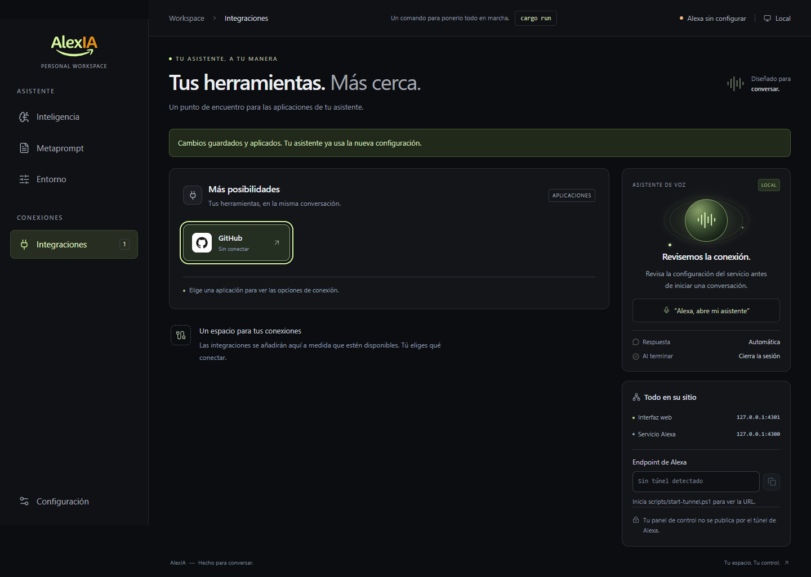
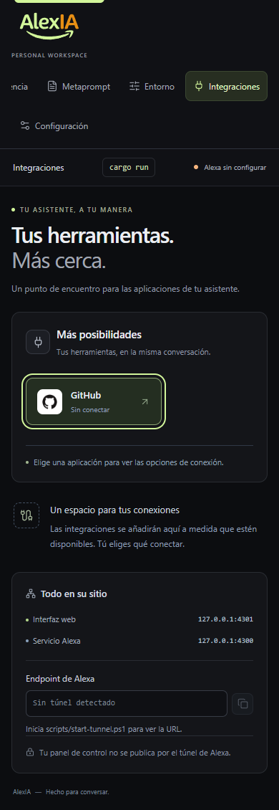

# Validación documental y de interfaz — 2026-11-03

Estado: **41 comprobaciones correctas y una observación funcional abierta**.

## Alcance

Se utilizó la skill oficial [Playwright CLI](https://github.com/microsoft/playwright-cli/tree/main), instalada primero en el directorio personal de skills de Codex. Ejecutable 0.1.23, Chrome, Node 24.21.0. No se conectaron cuentas externas ni se implementaron los conectores propuestos.

Servidor real: binario compilado de AlexIA con `UI_MODE=static`, backend `127.0.0.1:4300` y UI `localhost:4301`. Configuración temporal en `target/integration-plans/runtime`; ALEXA_SKILL_ID vacío y secreto estrictamente sintético para redacción. Sin mocks de peticiones, sin credenciales IA y sin llamadas a Antigravity.

## Preparación y comandos ejecutados

1. Instalación de skill con `install-skill-from-github.py --repo microsoft/playwright-cli --path skills/playwright-cli`.
2. Instalación del ejecutable oficial con `npm install --global @playwright/cli@latest`; versión observada 0.1.23.
3. `cargo build --locked --offline` y `npm --prefix ui run build`, ambos correctos.
4. Copia de assets compilados y metaprompt al runtime temporal; `.env` fixture sin credenciales.
5. Inicio del binario desde ese directorio; navegador y servidor ejecutados en el mismo entorno autorizado tras diagnosticar restricción de sockets inicial.
6. `playwright-cli -s=alexia-integration-plans open http://localhost:4301 --browser=chrome` y `goto` para conectar al servidor operativo.
7. `playwright-cli -s=alexia-integration-plans run-code --filename=smoke.js`, desde `target/integration-plans`.

El script temporal conserva las aserciones de esta sesión en `target/integration-plans/smoke.js` y no es dependencia del producto. El [JSON de resultados](playwright-result.json) se conserva junto a este informe. La primera llamada que recargó una página con beforeunload produjo salida de modal; se repitió el recorrido con salida de resultados explícita. La ejecución final devolvió las 41 comprobaciones siguientes.

## Comprobaciones observadas

1. UI real cargada y título correcto.
2. Alexa informa sin configurar en fixture.
3. GET settings real devuelve 200.
4. API redacta secreto sintético.
5. Secreto informa configurado sin valor.
6. Sin marcador local se rechaza.
7. Origin externo se rechaza.
8. Cabecera forwarded se rechaza.
9. Servidor público no expone settings.
10. Servidor público no expone túnel administrativo.
11. Health conserva Alexa bloqueada sin credenciales.
12. Alexa sin ID conserva 503.
13. API futura de integraciones todavía no existe.
14. Guardado normaliza solo el metaprompt fixture.
15. Fixture LF inicia sin cambios pendientes.
16. Panel Integraciones visible.
17. GitHub permanece sin conectar.
18. Modal GitHub abre.
19. Conectar GitHub permanece deshabilitado.
20. Escape cierra modal GitHub.
21. Foco vuelve al botón GitHub.
22. Editar muestra barra de guardado.
23. Restaurar contenido oculta barra.
24. Filtro GEMINI muestra dos variables.
25. Campo de secreto fixture está vacío y protegido.
26. Nombre de variable inválido se rechaza.
27. Variable nueva queda solo en editor.
28. Descartar pide confirmación de edición.
29. Variable descartada no persiste.
30. Guía Alexa abre.
31. Sin túnel copiar está deshabilitado.
32. Guía abre Entorno.
33. Configuración inválida devuelve 422.
34. Error no modifica revisión persistida.
35. Guardado preserva secreto sin exponerlo.
36. Panel móvil accesible.
37. Sin desbordamiento horizontal a 390 px.
38. Modal GitHub móvil abre.
39. Sin excepciones JavaScript.
40. Sin errores de consola en recorrido UI.
41. Sin warnings de consola.

## Observación OBS-01: cambios aparentes con CRLF

Reproducción: copiar el metaprompt CRLF al runtime, cargar UI y observar barra de guardado visible antes de editar. El textarea normaliza saltos a LF, mientras el valor recibido de settings conserva CRLF. `ui/src/settings-state.js` compara ambos literalmente.

Impacto: aviso de cambios y posible confirmación de salida sin edición real. El guardado de la **copia fixture** transforma el contenido a LF y el estado queda limpio. El archivo original permaneció intacto por comparación SHA-256. No se corrigió código durante esta entrega de planes; PLAN00 incorpora la condición a resolver y probar antes del nuevo catálogo.

Recomendación de implementación: normalizar únicamente saltos CRLF/LF al comparar metaprompt, manteniendo espacios y diferencias significativas. Añadir una prueba que falle con CRLF frente a LF y otra que conserve detección de una edición real.

## Capturas y revisión visual

Escritorio: 1440x900. La captura de página completa puede ser más alta que el viewport.

Móvil: 390x844. Ancho observado y scrollWidth global: 390. La navegación superior utiliza desplazamiento horizontal propio.

## Límites y limpieza

- Revisión documental: 21 planes numerados, 20 aplicaciones y 22 ejemplos JSON válidos; enlaces locales comprobados y sin patrones de credenciales. El reporte mecánico está en [document-check.json](document-check.json).
- Cero errores, advertencias de consola o excepciones JavaScript en el recorrido final.
- `.env` y `prompts/meta-prompt.txt` originales no cambiaron (SHA-256 antes/después).
- No se probó login externo, API remota de las veinte apps, proveedor IA, firma real de Amazon o dispositivo físico.
- No se ejecutó suite Rust completa: la entrega modifica documentación; se compiló el binario necesario para la prueba y se verificó la UI/API real con CLI.
- Skill y ejecutable permanecen instalados por solicitud del propietario. Los procesos temporales se cierran al terminar la validación.
